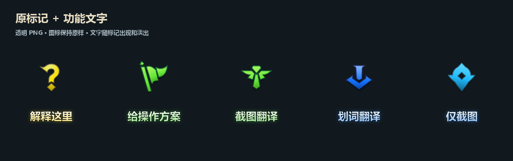

# AI-Ping

**标记哪里，就从哪里开始问 AI。**

AI-Ping 是一个 Windows 桌面 AI 标记助手：在任何软件中打开轮盘，选择“解释这里”“截图翻译”或“给操作方案”，再框选一块屏幕。答案会在选区旁的置顶小浮窗中显示，可以继续追问、复制答案，也可以展开完整面板。

基于 [lolPing](https://github.com/darrenprx/lolPing) v0.5.1 改装，保留原有信号轮盘、透明标记、动画和音效，增加文字提示、截图、翻译及两种可切换的 AI 接入。



[下载 Windows 便携版](https://github.com/yc0203/AI-Ping/releases/latest) · [让 AI 帮你安装](#让-ai-帮你安装) · [详细安装指引](docs/INSTALL.md) · [MIT 许可证](LICENSE)

## 能做什么

| 功能 | 用法 |
| --- | --- |
| 解释这里 | 截取一个界面、按钮或报错，让 AI 解释含义和下一步 |
| 给操作方案 | 截取当前软件界面，描述目标，让 AI 提供操作步骤 |
| 截图翻译 | 框选包含外语的区域，识别并翻译文字 |
| 划词翻译 | 在目标软件选择文字后翻译；读取失败可改用截图 |
| 仅截图 | 框选后直接复制或保存 PNG，不调用 AI |
| 就地问答 | 在选区旁的小浮窗看流式答案、追问或复制，无需切回主面板 |
| 个性化标记 | 自定义每个标记的功能、文字、图标和 WAV／OGG／MP3 音效 |

“给操作方案”提供建议供你执行，当前版本不代替你点击或操作其他软件。

## 快速开始

1. 在 [Releases](https://github.com/yc0203/AI-Ping/releases/latest) 下载 `AI-Ping-0.1.0-win-x64.zip` 和校验文件，解压到可写目录。运行包不含个人配置或密钥。
2. 双击 `AI-Ping.exe`，打开“AI 与标记设置”，选择 **本机 Codex** 或 **API 服务** 并保存。也可以让 AI 使用随包附带的 `tools/configure-ai.ps1` 完成配置。
3. 默认按住 **Alt + 左键拖动** 打开信号轮盘，选一个功能；热键以原设置面板中的配置为准，也可直接点击 AI 面板的功能按钮。
4. 截图时**按住左键拖出矩形，松开确认**；Esc 或右键取消。单击不会提交空截图。
5. 在选区旁的小浮窗预览，点击“发送并解答”。答案在这里流式显示，支持继续追问、Ctrl+Enter 发送、复制、停止、重新框选和展开完整对话。

托盘菜单的“AI-Ping 标记助手”可以重新打开面板。关闭面板后程序仍在托盘运行；配置脚本运行前需要从托盘菜单退出程序。

## 让 AI 帮你安装

需要能访问你本机终端和文件的 AI 编程助手，例如 Codex、Claude Code 或 Cursor。把下面一段话复制给它；安装目录可以自行替换。**登录授权和密钥需要你本人提供**，AI 可以完成其余安装、配置和检查，不能凭空替你生成有效凭据。

### 方式一：使用本地 Codex

```text
请在我的 Windows 电脑上安装并配置 AI-Ping，项目地址：
https://github.com/yc0203/AI-Ping
安装目录使用当前工作区下的 AI-Ping。请实际执行，不要只给步骤。

先读取仓库 README.md 和 docs/INSTALL.md。优先从这个仓库的最新正式 Release
下载 Windows x64 便携 ZIP 和 SHA256SUMS.txt，核对哈希后解压；目录已有程序时
先检查并保留 data，不要覆盖个人配置。没有合适的 Release 时按文档从源码构建。

AI 使用本机 Codex。检查是否安装了可用的 Codex CLI，以及 codex login status；
已有登录就复用，不读取或输出 auth.json、登录令牌。没有安装时按照官方文档安装；
需要浏览器登录或系统安装授权时再让我操作。Windows 如果只有 codex.cmd，
请找到该 npm 包内对应本机架构的真实 codex.exe，不要把 .cmd 填进 AI-Ping。

确认 AI-Ping 已从托盘退出，然后使用随包 tools/configure-ai.ps1：
-Provider codex -ExePath <AI-Ping.exe完整路径> -CodexPath <codex.exe完整路径>
模型留空沿用本机默认值，不修改我的全局 Codex 模型或供应商设置。

最后启动 AI-Ping，确认配置写入且本机 Codex 检测成功，检查截图框选和浮窗能打开。
未实际发送图片请求时，不要声称模型图片能力已验证。请告诉我安装目录、启动入口、
当前接入方式，以及还有哪些步骤需要我本人完成。
```

### 方式二：使用其他兼容 API

先把下面的地址、模型和协议改成你的服务提供商给出的值；模型必须支持图片输入，才能解释或翻译截图。支持 **Responses** 和 **Chat Completions**，不直接支持其他厂商的专用协议。

```text
请在我的 Windows 电脑上安装并配置 AI-Ping，项目地址：
https://github.com/yc0203/AI-Ping
安装目录使用当前工作区下的 AI-Ping。请先读取 README.md 和 docs/INSTALL.md，
实际下载安装并配置，而不是只列步骤。优先使用本仓库正式 Release 的 Windows x64
便携 ZIP，下载后用 SHA256SUMS.txt 校验；没有合适版本再从源码构建。

这次选择 API 接入：
Base URL：<替换为服务地址，例如 https://api.example.com/v1>
模型名称：<替换为服务提供商的视觉模型名称>
协议：<responses 或 chat，按服务提供商支持情况填写>

请检查地址、模型和协议是否完整。API Key 不要让我贴在聊天里，也不要写入代码、
脚本参数、日志或 Git 仓库；通过配置脚本的隐藏输入让我在本机输入。
如果我已经在当前进程设置 AI_PING_API_KEY，可使用 -UseEnvironmentKey，
但不要打印其值，不要擅自从其他软件的密钥文件复制凭据。

AI-Ping 退出后，使用随包 tools/configure-ai.ps1：
-Provider api -ExePath <AI-Ping.exe完整路径> -BaseUrl <上面的地址>
-Model <上面的模型> -ApiMode <上面的协议> -PromptForKey
它会通过一次性子进程环境变量交给程序，并由系统加密保存。配置时保留已有标记和个性化设置。

最后启动程序。检查选区预览和浮窗；要验证真实 API 时，先使用不含个人信息的示例
并告知我会发送到哪一家服务。根据实际返回判断是否成功，不把“配置已保存”当作
“模型调用成功”。给出启动入口和后续切换接入方式的方法。
```

完整参数、手动安装、源码构建和排错见 [docs/INSTALL.md](docs/INSTALL.md)。

## AI 接入说明

| 接入方式 | 需要什么 | 配置方式 |
| --- | --- | --- |
| 本机 Codex | 可运行的 Codex CLI、有效登录或其已有服务配置 | 自动寻找或选择真实 `codex.exe`，模型可留空；保存后检测连接 |
| 兼容 API | Base URL、视觉模型、可选 API Key | 选择 Responses 或 Chat Completions；远程地址要求 HTTPS，loopback 本机服务可用 HTTP |

本地 Codex 指调用你电脑上的 Codex 进程，**不代表模型一定在本机推理或离线运行**。请求由你的 Codex 配置和所选服务处理；费用、额度和模型能力取决于账户与服务。AI-Ping 不读取或复制 Codex 登录文件，不替你登录。

截图和文字先本地预览，点击发送后才提交。API Key 通过 Electron 的系统加密能力保存；便携程序旁的 `data` 是本机私有数据，不要分享或上传。正常关闭程序后不保留对话记录。Codex 接入使用只读沙箱；应用不会批准工具执行或自动操作电脑。

## 源码开发

要求 Node.js 22+、Windows x64，以及 Visual Studio 2022 Build Tools 的 C++ 桌面工具链。便携 Release 的日常使用不需要这些开发依赖。

```powershell
git clone https://github.com/yc0203/AI-Ping.git
cd AI-Ping
npm ci
npm run build:helper
npm run typecheck
npm test
npm run dev
```

打包安装程序使用 `npm run dist`，输出在 `release/`。仅构建解包运行目录可用 `npm run build` 后执行 `npx electron-builder --win --x64 --dir --publish never`。`npm run package:local` 是本工作区复用相邻官方运行时的辅助命令，不适用于普通新克隆。

源码位于 `src`，原生输入辅助程序位于 `native`，测试位于 `tests`。透明文字 PNG 及生成器位于 `assets/labels` 和 `design/marker-text`。开发模式配置位于 `build/local-data`；便携版配置位于程序旁的 `data`。

## 当前状态与限制

- 第一版以 Windows x64 为主要支持平台。macOS 构建继承自上游，新增 AI 功能尚未经过 macOS 实机验证；macOS 划词尚未实现。
- Windows 默认使用软件渲染和不透明面板背景，以规避黑块和闪烁；透明标记及动画保留。
- 划词依次尝试 Windows UI Automation 和复制选区；自绘控件、禁止复制或权限更高的软件可能失败，可以改用截图翻译。尚未验证所有真实软件的划词兼容性。
- 736 项自动测试、类型检查及生产构建已验证。截图、浮窗、模拟 API 流式回答与追问经过实际 Electron 验证；本机 Codex 登录检测和图片读取已验证。未对所有第三方 API 服务实测。
- 安装配置脚本对 Codex 检查本机连接；对 API 验证配置格式并加密保存，不会自动发送截图或产生推理请求。
- Ctrl+Alt+A 面板快捷键遇到占用时，可用托盘菜单或直接运行程序。当前未启用自动更新。

## 致谢与许可证

基于 [darrenprx/lolPing](https://github.com/darrenprx/lolPing)，保留上游版权与 [MIT 许可证](LICENSE)。AI-Ping 的新增代码按相同许可证提供。

英雄联盟图像和音效属于其权利人，代码许可证不授予这些第三方素材的独立版权。详见 [上游说明](docs/upstream-README.md) 中的素材声明。你可以替换为自己的图像和音效。
